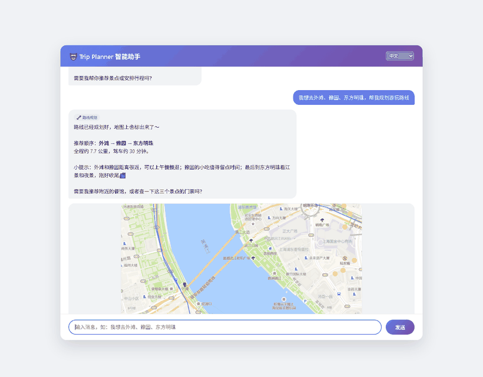
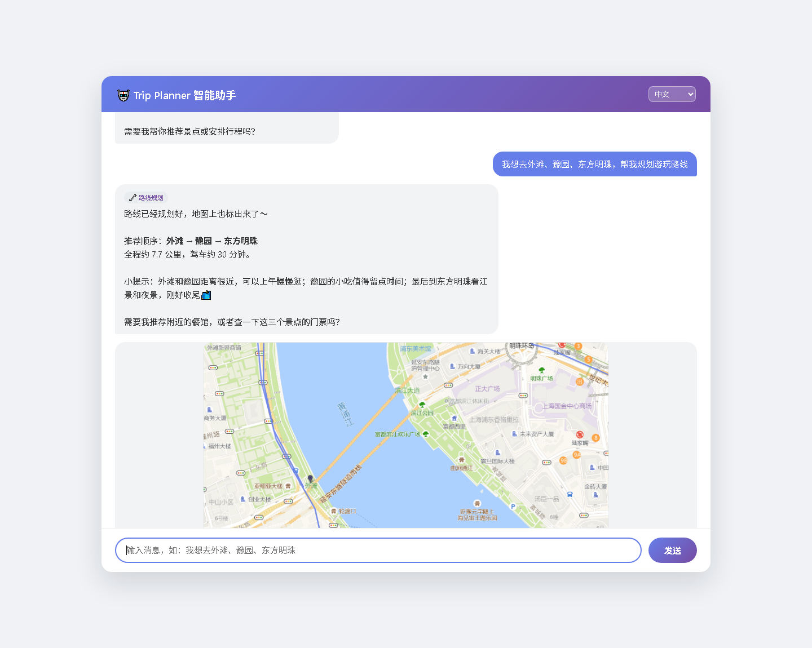
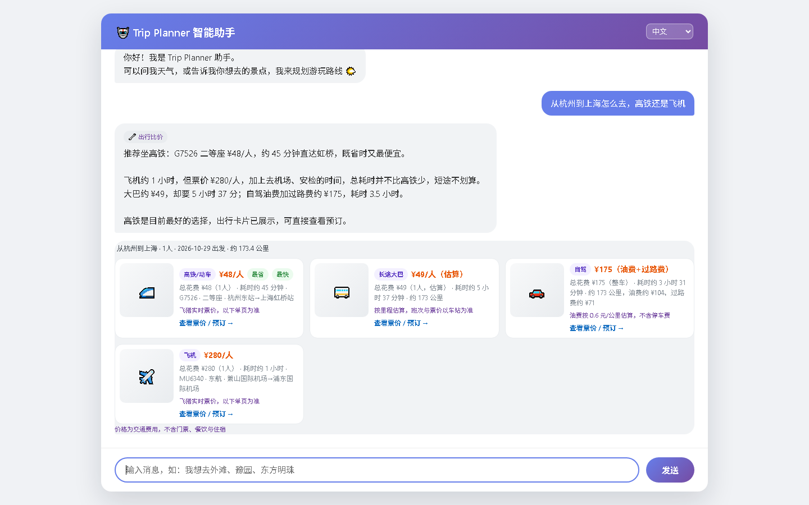
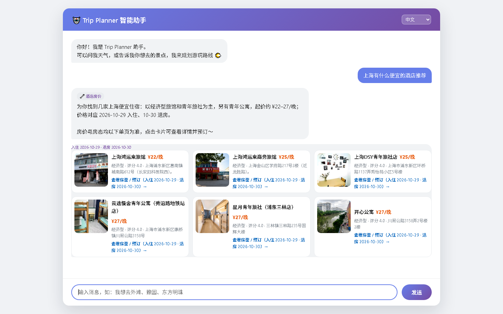
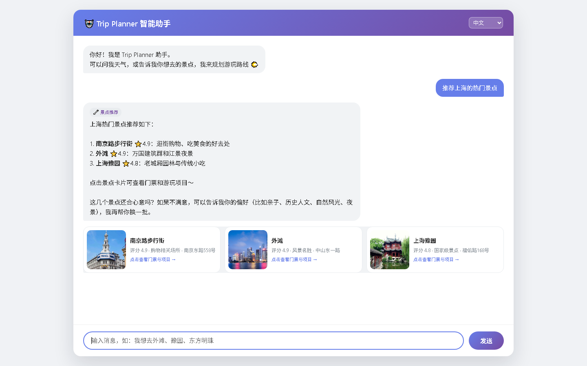
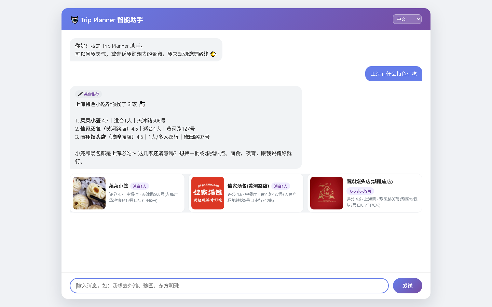
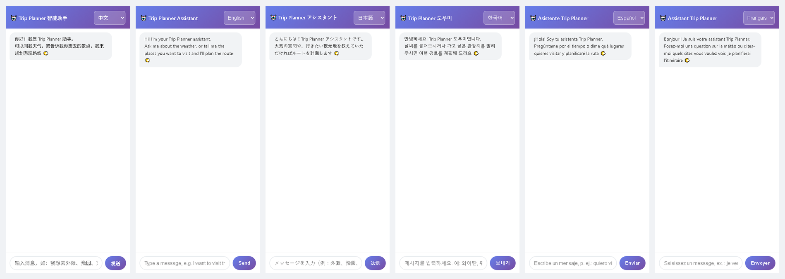
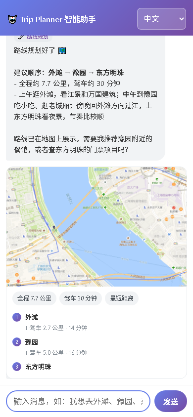
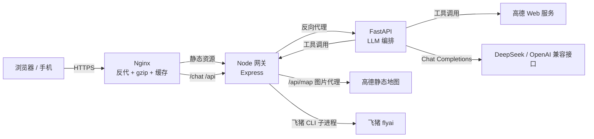

# Trip Planner · 面向外国游客的 AI 旅行助手

> 一个能查天气、规划景点路线、推荐餐馆、查酒店实时房价、比价交通的 AI 旅行助手。
> 面向来华外国游客，支持 6 种语言；后端做了并发治理、时间预算与降级，500 并发压测不崩。




<p align="center">
  
</p>

---

## 目录

- [为什么做这个](#为什么做这个)
- [功能一览](#功能一览)
- [界面截图](#界面截图)
- [系统架构](#系统架构)
- [LLM 工程设计](#llm-工程设计)
- [并发与稳定性](#并发与稳定性)
- [安全设计](#安全设计)
- [移动端适配](#移动端适配)
- [踩坑记录](#踩坑记录)
- [快速开始](#快速开始)
- [部署](#部署)
- [项目结构](#项目结构)
- [演示视频](#演示视频)
- [已知限制与 Roadmap](#已知限制与-roadmap)
- [English Summary](#english-summary)

---

## 为什么做这个

外国游客来华旅行，真正的门槛不是"不知道去哪"，而是**信息与工具割裂**：

- 天气要查一个 App，路线要开地图，门票要在 OTA 找，酒店价格又要换一个平台；
- 语言不通时，中文地名、中文地址、中文评价几乎无法使用；
- 大模型什么都能聊，但**无法给出实时、可预订、可导航的结果**——而这些恰恰是旅行最需要的。

所以这个项目的核心不是"套一个聊天框"，而是把 **LLM 做成调度层**：模型负责理解意图、选择工具、组织语言；真实数据（高德地图、飞猪实时价格）由工具提供；结构化结果直接渲染成卡片，模型不负责"念数据"。

一句话：**模型管决策，代码管事实。**

## 功能一览

| 能力 | 实现方式 | 用户看到什么 |
|---|---|---|
| 查城市天气 | 高德天气 API | 今日 + 未来几天，温度/风力/穿衣建议 |
| 景点推荐 | 高德 POI 检索 | 评分、地址、实景图卡片，可点击查门票 |
| 路线规划 | 高德驾车路径 + 静态地图 | 地图截图、总距离/耗时、推荐游览顺序 |
| 附近餐馆 / 特色小吃 | 高德 POI + 偏好筛选 | 餐馆卡片，标注"适合 1 人/多人" |
| 住宿 / 酒店房价 | 高德 POI + 飞猪 CLI | 电话、地址；或实时房价（注明入住日期与起价） |
| 交通比价 | 飞猪火车/航班 + 自驾估算 | 高铁/飞机/大巴/自驾四方案对比 |
| 门票与游玩项目 | 飞猪 CLI | 项目卡片 + 实时价格 + 预订链接 |
| 多语言 | 前端 i18n + 提示词语言约束 | 中/英/日/韩/西/法 六种语言，含界面与回复 |

> 范围约束：只回答以上五类旅行问题。问「1+1 等于几」「今天有什么新闻」「写一首诗」这类越界问题，不会作答，而是按当前界面语言返回功能清单（见 [LLM 工程设计](#llm-工程设计)）。

## 界面截图

**路线规划**：地图、驾车耗时、游览顺序一次给全


**交通比价**：高铁 / 飞机 / 大巴 / 自驾四方案并列，标注价格来源



**酒店实时房价**：价格带入住日期，注明"起价、以下单页为准"



**景点与门票**：评分、实景图、可点击进入门票与项目




**附近美食**：口味偏好筛选，标注适合人数



**六种语言**（界面文案、占位符、助手回复同步切换）



**移动端**：安全区、44px 触控尺寸、无横向滚动



## 系统架构



**一次请求的生命周期**

1. 浏览器 `POST /chat`（`message` + `history` + `language` + `client_id`）
2. Node 网关：请求闸门（250 inflight / 250 排队）→ 客户端 + IP 双桶限流 → 20s 总预算
3. FastAPI：拼装系统提示词（规则 + 范围约束 + 固定话术 + 语言）→ 调用 LLM
4. LLM 返回 `tool_calls` → 并发执行工具（最多 3 轮）→ 工具结果回填 → 再次调用 LLM 生成自然语言
5. 工具产生的结构化数据（路线/景点/酒店/交通…）作为 `artifact` 与 `reply` 一起返回
6. 前端把 `artifact` 渲染成卡片，把 `reply` 渲染成气泡；地图图片走 `/api/map` 代理，避免泄露 Key

## LLM 工程设计

这是项目的重点，也是我认为最值得讲的部分。

**1. 工具编排：让模型只做"选择"，不做"计算"**

- 8 个工具：`fetch_weather`、`plan_trip_route`、`recommend_attractions`、`recommend_food`、`recommend_stay`、`recommend_hotel_deals`、`recommend_products`、`plan_transport`
- 单轮最多 3 次往返；同一轮内多个 `tool_calls` 用 `asyncio.gather` 并发执行
- 工具返回**精简文本**给模型（控制 token），同时返回**完整结构**给前端（用于卡片）
- 价格、评分、时刻一律来自工具，提示词里明确禁止模型编造

**2. 时间预算分层：让超时"逐层收敛"而不是一起爆**

| 层级 | 预算 | 作用 |
|---|---|---|
| Node 网关 | 20s | 兜底：超过直接返回繁忙提示 |
| FastAPI 会话 | 18s | 先于网关收敛，保证有降级结果 |
| 单次 LLM | 8s | 避免一次慢调用吃掉全部预算 |
| 飞猪 HTTP 工具 | 12s | 覆盖 CLI 排队 + 执行 |
| 飞猪 CLI 子进程 | 9s | 实测 6~7s，留出冷启动余量 |

超时后不是抛 500，而是返回**当前语言的降级文案**，并在响应里带 `degraded: true`。

**3. 范围约束：把"闲聊机器人"变成"业务助手"**

- 系统提示词规定只服务五类：天气、景点路线、餐饮、住宿房价、交通比价
- 越界问题（算术、新闻、学术、编程、翻译、写作、医疗等）**不回答、不解释、不调用工具**，只逐字输出按界面语言预置的功能清单
- 固定话术用占位符内联进提示词，保证 6 种语言输出一致，不会漏条目
- 实测：「1+1等于几」「今天有什么新闻」「写一首关于北京的诗」→ 固定清单；「北京天气怎么样」「推荐北京好吃的小吃」→ 正常调用工具

**4. 上下文与成本控制**

- 服务端只保留最近 10 条历史，前端裁剪到 6 条 / 单条 1000 字，避免 token 爆炸与 422
- `LLM_MAX_TOKENS=800`，回答控制在 100~200 字（卡片已承载细节）
- 回答缓存 120s（仅缓存无历史的首轮问题，避免串话）

## 并发与稳定性

| 指标 | 实测值 | 说明 |
|---|---|---|
| 500 并发（桩后端） | 全部 200，最大 5.3s | 验证网关闸门与排队逻辑 |
| 超载保护 | 40 成功 + 60 快速 503 | 队列满后立即拒绝，不再拖慢已接入请求 |
| 真实链路 · 天气 | 3.8s | LLM + 高德工具 |
| 真实链路 · 缓存命中 | ~10ms | 相同问题 120s 内直接返回 |
| 真实链路 · 飞猪检索 | 6.9s | CLI 子进程，9s 预算内 |

治理手段：

- **请求闸门**：250 inflight + 250 队列，超出直接 503（带本地化文案）
- **双桶限流**：按 `client_id`（15 次/分）+ 按 IP（300 次/分），防止伪造 client id 绕过
- **并发隔离**：LLM 信号量 200、工具信号量 40、高德 QPS 3 + inflight 3、飞猪按业务分池
- **缓存击穿防护**：按 key 加锁 + 双检，热门景点同时被请求时只回源一次
- **进程配置**：Node `keepAliveTimeout 65s`、容器内存上限、非 root 用户、日志轮转

## 安全设计

- **API Key 后端化**：高德 Key 只在服务端注入，前端拿到的是 `/api/map?...` 相对地址；Node 侧再做一次图片代理 + IP 限流
- **异常脱敏**：工具异常统一返回"工具执行失败，请稍后重试"，完整堆栈只进日志
- **URL 白名单**：所有外部链接/图片经 `safeHttpUrl()` 校验，只允许 `http/https`
- **输入约束**：消息 2000 字、历史 20 条、已推荐住宿 50 条，超限 422 而不是崩
- **代理信任可配**：`TRUST_PROXY` 默认 0，只有在 Nginx/平台代理后才设为 1

## 移动端适配

移动优先 + 媒体查询 + Flex/Grid，桌面端样式零改动：

- `viewport-fit=cover` + `interactive-widget=resizes-content`，键盘弹起不遮挡输入框
- 顶部/底部叠加 `env(safe-area-inset-*)`，适配刘海屏与横屏
- 输入框 16px 字号（避免 iOS 聚焦自动放大）、发送按钮 44px 高
- 长英文、长地址、长景点名统一 `overflow-wrap: anywhere`，卡片在 320px 宽下仍不溢出
- 实测 320 / 360 / 390 / 844×390 横屏 / 1440 五档：`scrollWidth === clientWidth`，溢出元素 0

## 踩坑记录

| 问题 | 根因 | 处理 |
|---|---|---|
| Cloudflare 隧道访问总超时 | Node 默认 `keepAliveTimeout` 5s，隧道复用已关闭连接，POST 不重试 | 提升到 65s，并同步 `headersTimeout` / `requestTimeout` |
| 某景点查询偶发 502 | 飞猪 CLI 在 Windows 上输出 JSON 后异常退出，实测 6.3s，而预算是 6s | 预算提到 9s，只对 429 重试，共享 deadline |
| 同一景点并发请求打穿缓存 | 缓存过期瞬间全部回源 | `keyed_lock` 按 key 加锁 + 锁内二次检查 |
| 聊天与卡片 loading 互相覆盖 | 两个异步请求共用一个 loading 状态 | 改为 `pendingRequests` 计数器 |

## 快速开始

```bash
# 1. 配置环境变量（.env 已被 gitignore）
cp .env.example .env
# 填入 OPENAI_API_KEY / GAODE_API_KEY / FLYAI_API_KEY

# 2. 启动后端（FastAPI + LLM 编排）
cd backend
pip install -r requirements.txt
cd app
python -m uvicorn server:app --host 127.0.0.1 --port 8000

# 3. 启动前端网关（静态页面 + /chat 反代 + 飞猪 CLI）
cd frontend
npm ci
node server.js        # http://127.0.0.1:3000
```

健康检查：`GET /healthz`（两个服务都有）。

## 部署

**方式一：阿里云 ECS + Docker Compose + Nginx（推荐）**

```bash
docker compose up -d --build
# Nginx 配置见 deploy/nginx/trip-planner.conf（改成你的域名后 certbot 签证书）
```

**方式二：Render Blueprint**

仓库根目录已带 `render.yaml`，在 Render 控制台 New → Blueprint 选择本仓库即可（web + 私有 api 两个服务）。

**容量相关环境变量**（不填使用默认值）：`CHAT_TIMEOUT_MS`、`MAX_INFLIGHT_CHAT`、`MAX_QUEUE_CHAT`、`MAX_INFLIGHT_PER_CLIENT`、`CHAT_RATE_LIMIT_PER_MIN`、`IP_RATE_LIMIT`、`GAODE_QPS`、`FLYAI_*_CONCURRENCY`、`FLYAI_JSON_TIMEOUT_MS`。

## 项目结构

```
backend/app
├── server.py              # FastAPI 入口：提示词、工具编排、预算、限流、缓存
└── services/
    ├── amap_client.py     # 高德封装：QPS 闸门、异常脱敏、静态地图代理
    ├── route_planner.py   # 驾车路线 + 静态地图 + 缓存
    ├── attraction_finder.py / food_finder.py / stay_finder.py
    ├── product_finder.py / hotel_finder.py / transport_finder.py
    ├── skill_service.py   # 调用 Node 侧 /api/* 的内部 HTTP 客户端
    └── keyed_lock.py      # 按 key 加锁，防缓存击穿

frontend
├── server.js              # Express 网关：静态托管、/chat 反代、闸门、限流、gzip
├── flyai-runner.js        # 飞猪 CLI 执行器（命令白名单、超时、脱敏）
├── flyai-search.js        # JSON 解析、并发闸门、TTL 缓存、请求合并
├── products.js / hotels.js / transport.js
└── public/index.html      # 单文件前端：聊天、卡片渲染、6 语言 i18n、移动端样式

deploy/nginx/trip-planner.conf   # ECS 反代配置（含图片缓存与错误兜底）
docker-compose.yml / render.yaml # 两套部署编排
```

## 演示视频

- 60 秒演示：[待补充 B 站 / YouTube 链接]
- 分镜、旁白与字幕脚本见 [docs/video-script.md](docs/video-script.md)

## 已知限制与 Roadmap

- 飞猪数据依赖 CLI 子进程，冷启动较慢；后续改为常驻服务或官方 API
- 限流与缓存为进程内状态，多实例部署前需要接 Redis
- 路线规划目前是"景点顺序 + 驾车耗时"，尚未做多日行程的时间窗约束
- 计划补充：多日行程、行程分享链接、用户收藏、真实评价摘要

## English Summary

**Trip Planner** is an AI travel assistant for foreigners visiting China. It combines an LLM orchestration layer with real-time data from Amap (weather, POI, driving routes, static maps) and Fliggy (tickets, hotel rates, train/flight prices), and answers in 6 languages (zh/en/ja/ko/es/fr).

Engineering highlights:

- **Tool-calling orchestration**: 8 tools, up to 3 rounds, concurrent tool execution, structured artifacts rendered as UI cards (the model narrates, the code owns facts).
- **Layered time budgets**: 20s gateway / 18s session / 8s LLM / 12s tool / 9s CLI, with localized graceful degradation instead of 500s.
- **Scope guard**: only five travel intents are served; out-of-scope questions get a fixed, localized capability list.
- **Concurrency control**: request gate (250 inflight + 250 queued), dual-bucket rate limiting, per-tool semaphores, keyed-lock cache protection.
- **Observability & safety**: API keys never reach the browser, secrets redacted from errors, SSRF-safe URL allowlisting, non-root containers.
- **Mobile-first UI**: safe-area insets, 44px touch targets, no horizontal overflow from 320px up.

Tested at 500 concurrent requests (all 200, max 5.3s) with overload protection returning fast 503s beyond capacity.
